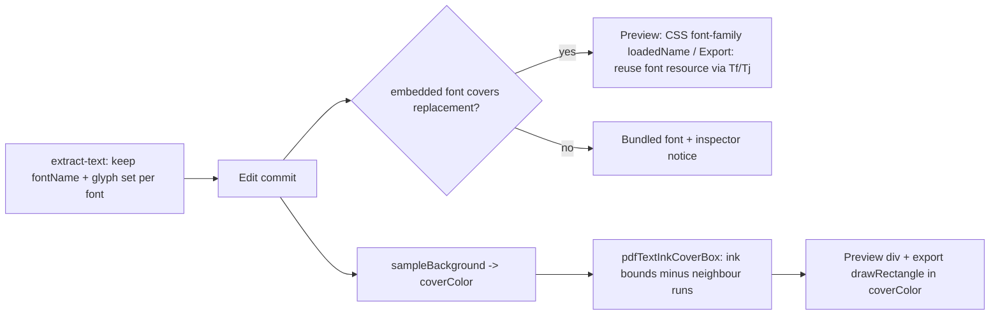

# PDF text edit fidelity

Research: [docs/research/pdf-text-edit-fidelity.md](docs/research/pdf-text-edit-fidelity.md). Vocabulary: [GLOSSARY.md](GLOSSARY.md) (Run, Dirty run, Replacement, Original ink, Cover, Removal).

## Decisions (from grilling)

- The preview and the export must match.
- **Font:** Reuse the run's embedded font when it has every character of the replacement. Otherwise draw the whole run in the bundled font and show a notice in the inspector.
- **Export font:** Reuse the original PDF font resource. When that fails, use the bundled font. Do not turn on `fontExtraProperties`.
- **Cover:** Use a sampled background color, bounded to the original ink and clipped against other runs. When one color fills less than about 70% of the sampled ring, still use the most common color and show a hint.
- **Text color:** Verify and fix the `#111827` fallback.
- **Out of scope:** Removal (content-stream rewriting), and covers for images, vectors and OCR words.

## 1. Cover color

- In [lib/pdf/sample-caption-ink.ts](lib/pdf/sample-caption-ink.ts), add `sampleBackground(imageData, ring, excludeRects)`. Unlike `isPaper`, it keeps near-white pixels. It returns `{ color, dominance }` from the most common quantized color in a 2 to 4 px ring around the cover, skipping other runs' boxes.
- Call it alongside [lib/pdf/sample-link-caption-from-page.ts](lib/pdf/sample-link-caption-from-page.ts). It reuses the off-screen page canvas from `getDisplayedPageContentCanvas` in [lib/pdf/pdf-annotation-content-cache.ts](lib/pdf/pdf-annotation-content-cache.ts), which is rendered in displayed space (source `/Rotate` only) so displayed rects map to pixels by scale.
- _As built:_ `ensurePdfTextMeasured` ([lib/pdf/sample-pdf-text-cover.ts](lib/pdf/sample-pdf-text-cover.ts)) runs when editing starts or a run first turns dirty. It is not in the store's commit path. The store is synchronous and has no canvas, and the export worker shares it. The result (cover color, cover rects and reusable font glyphs) is written by id through `editorStore.applyPdfTextMeasurement`. That write skips undo and fills every history snapshot.
- Add `coverColor?: string` and `coverColorUncertain?: boolean` to `PdfTextObject` in [lib/editor/types.ts](lib/editor/types.ts).
- In [components/editor/pdf-text-layer.tsx](components/editor/pdf-text-layer.tsx), replace `bg-white` (line 84) with `style={{ backgroundColor: object.coverColor ?? "#ffffff" }}`.
- In [lib/pdf/export-pdf.ts](lib/pdf/export-pdf.ts), replace `rgb(1, 1, 1)` (lines 310 to 317) with `color(object.coverColor ?? "#ffffff")`.
- When `coverColorUncertain` is set, show a hint in [components/editor/pdf-text-inspector.tsx](components/editor/pdf-text-inspector.tsx).

## 2. Cover geometry

- In [lib/editor/object-utils.ts](lib/editor/object-utils.ts), replace `dirtyPdfTextCoverBox` with `pdfTextInkCoverBox(object, page, neighbours)`.
  - The vertical bound is the original string's ink, measured with canvas `measureText` (`actualBoundingBoxAscent` and `actualBoundingBoxDescent`) on the run's loaded font face. If that face is unavailable, fall back to `style.ascent`/`descent` without the 0.25 em floor from [lib/editor/coordinates.ts](lib/editor/coordinates.ts) (lines 163 to 171). Add about 1 px of bleed.
  - The horizontal bound is the original run's width plus `PDF_TEXT_COVER_LEFT_EM`. It no longer grows with the replacement width, because the cover now matches the background.
  - Subtract the ink boxes of other runs on the same page that overlap vertically. If the result would split into pieces, return a list of rects (`Rect[]`).
- Use the same helper in both preview (`pdf-text-layer.tsx` lines 116 and 256) and export (`drawDirtyPdfText`). Keep the caption underline extension.

## 3. Embedded font

**Extract:** In [lib/pdf/extract-text.ts](lib/pdf/extract-text.ts), keep `fontName` (the PDF.js `loadedName`) and the face `name` (BaseFont, for example `ABCDEF+GoogleSans-Medium`). Build a per-document map from `fontName` to the set of code points shown on any run in that font.

**Coverage:** Add `embeddedFontCovers(fontName, text)`, which checks that every code point of the replacement is in that set. Mark Type3 and missing-file fonts as never covering.

**Preview:**

- When the font covers the text, set `font-family: "<loadedName>", <bundled fallback>` in `pdf-text-layer.tsx` for both the dirty paint and the inline input.
- Make width fitting in `measurePdfTextWidth` and [lib/fonts/measure-text.ts](lib/fonts/measure-text.ts) use the same family.
- PDF.js keeps the face registered until `doc.cleanup()` ([lib/pdf/session.ts](lib/pdf/session.ts) line 535), so no option changes are needed.

**Export:** Add `lib/pdf/reuse-pdf-font.ts`.

- On the output page's `/Resources /Font`, find the font dictionary whose `/BaseFont` matches the face name.
- Read its `/ToUnicode` CMap with pdf-lib, invert it, and encode the replacement into code bytes. Simple fonts use one byte per character; Type0 fonts with `Identity-H` use two.
- Emit `BT /Fx size Tf ... Tj ET`, following the OCR raw-operator path in `export-pdf.ts` (lines 852 to 894).
- On any failure (no match, no `/ToUnicode`, unmapped character, Type3), return `null` and let `drawDirtyPdfText` use the current bundled font.

**Notice:** When coverage fails, show "Original font can't draw these characters; using a substitute" in the inspector.

**Width consistency:** Export width fitting must use the reused font's `/Widths` (or `/W` for CID fonts) so that `fittedPdfTextBox` agrees with the preview.

## 4. Replacement text color

- Load the sample PDF and check whether `extract-text-colors.ts` fails closed to `#111827` for this run. Follow the locked algorithm in [docs/research/pdf-text-extract-colors.md](docs/research/pdf-text-extract-colors.md).
- If it does, fix the matching gap. Likely causes are a count mismatch from inserted whitespace items, or a fill color set inside a form XObject. Add a test fixture for that case.
- _Status:_ `public/sample.pdf` aligns on every page (`test/sample-pdf-text-colors.test.ts`). It has no GoogleSans "Prompt" run, so the _Prompt Engineering_ deck itself is still unverified. Form XObject fills are now scoped by save/restore at `paintFormXObjectBegin`/`End`.

## Tests

- Extend [test/extract-text.test.ts](test/extract-text.test.ts) to cover glyph sets per font.
- Add unit tests for `sampleBackground`: an off-white ring, a mixed ring that gets flagged uncertain, and excluded runs.
- Add a `pdfTextInkCoverBox` test with two runs stacked at 1.0 em leading. The cover must not overlap the lower run, which covers the "i" dot case.
- Add a `reuse-pdf-font` round trip. Encoding "Prompts" against a font dict with `/ToUnicode` should produce the expected bytes. A missing character should return `null`.
- Run `pnpm dlx ultracite fix` and the existing test suite.

## Follow-ups (not in this plan)

- Removal through content-stream rewriting, as a separate research and plan.
- Sharing `coverColor` with image, vector and OCR covers.
- Embedding PDF.js font bytes with `fontExtraProperties`, once fontkit is shown to work on PDF.js-rebuilt fonts.
